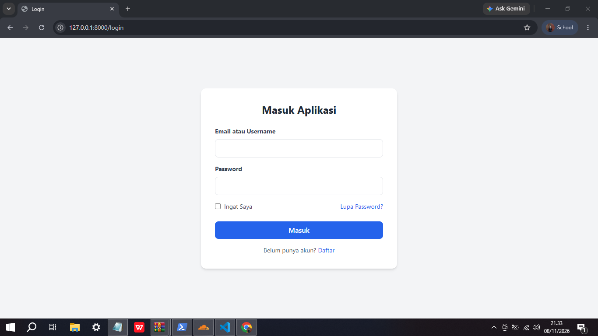
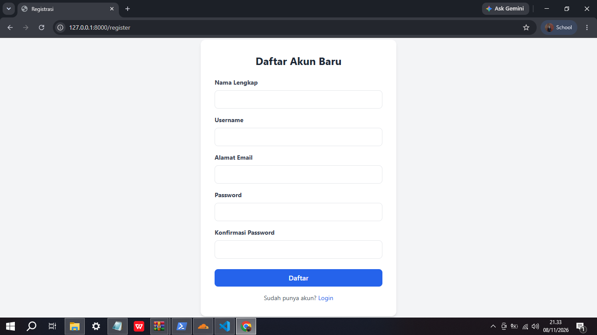
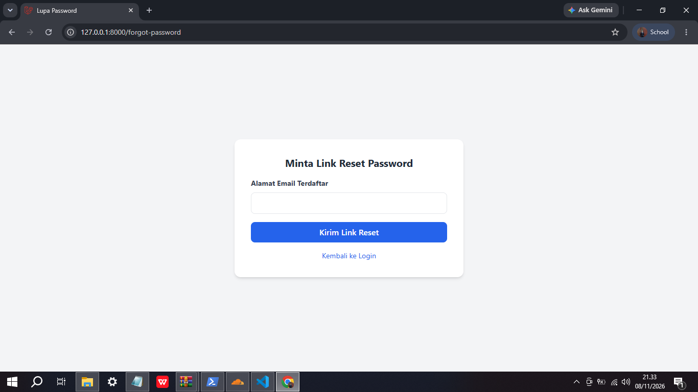
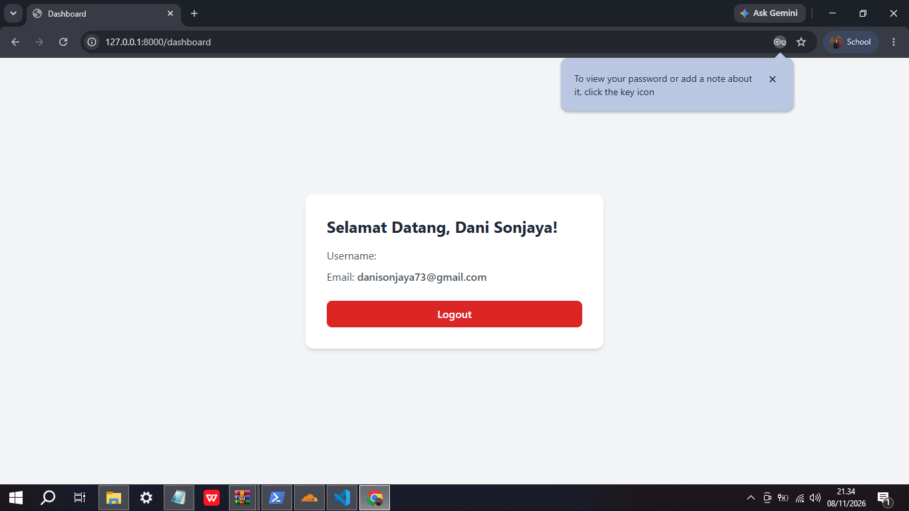
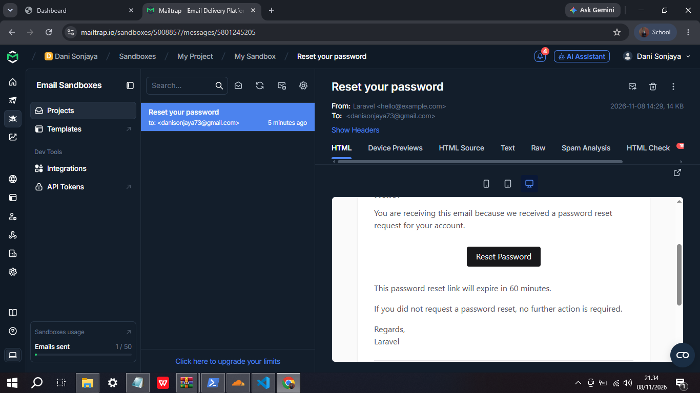

# Simple Laravel Authentication System

Aplikasi web autentikasi sederhana berbasis **Laravel** yang dilengkapi fitur registrasi pengguna, login, pemulihan kata sandi via pengujian email Mailtrap, serta halaman dashboard pengguna.

---

## 🛠️ Teknologi yang Digunakan

- **Backend Framework:** Laravel
- **Frontend:** HTML, CSS, JavaScript
- **Database:** MySQL / MariaDB
- **Email Service Testing:** Mailtrap Sandbox

---

## ✨ Fitur Utama

- **Login / Masuk:** Autentikasi menggunakan Email atau Username dan Kata Sandi dengan opsi *Ingat Saya*.
- **Registrasi Akun:** Pendaftaran pengguna baru (Nama Lengkap, Username, Email, Password, Konfirmasi Password).
- **Lupa Password:** Permintaan tautan reset password yang dikirim via email.
- **Pengujian Email (Mailtrap):** Integrasi sandbox untuk menguji penerimaan email reset password secara lokal.
- **Dashboard Pengguna:** Halaman khusus setelah pengguna berhasil terautentikasi.

---

## 📸 Tampilan Antarmuka

### 1. Halaman Login

*Tampilan form autentikasi masuk ke aplikasi.*

### 2. Halaman Registrasi

*Tampilan form pendaftaran akun pengguna baru.*

### 3. Halaman Lupa Password

*Tampilan form untuk mengajukan tautan reset password.*

### 4. Dashboard Pengguna

*Halaman utama yang diakses setelah pengguna berhasil masuk.*

### 5. Pengujian Reset Email (Mailtrap)

*Tampilan email reset password yang diterima di Mailtrap Sandbox.*